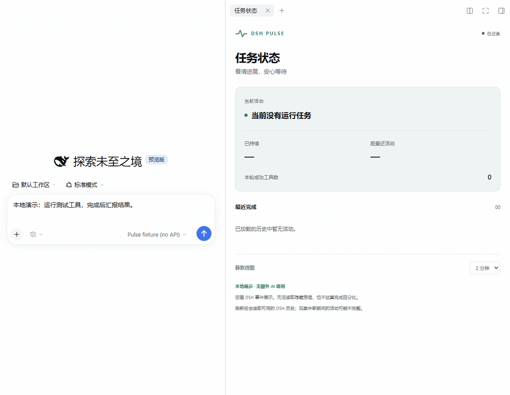

# DSH Task Pulse

English · [简体中文](README.md) · [Download v0.1.0](https://github.com/Yeti11H/dsh-task-pulse/releases/tag/v0.1.0)

A small task-status sidebar for DeepSeek Harness. See observable model activity, pending tools, known user-interaction waits, recent completed work, and quiet periods.

No additional model calls, backend service, prompt injection, or changes to tool execution.



The approximately 20-second recording uses a local test model and delayed tool in a real DSH session. It demonstrates observable status transitions, not real-model response speed. [Static screenshot](docs/dsh-complete.png). This project's package is `dsh-task-pulse`; it is unrelated to the existing third-party `dsh-pulse` package.

## Install the preview

Requires Node.js **>=24.9.0**. This branch declares host compatibility as **`>=0.2.2-rc.1 <0.3.0`**; the declared range is broader than the versions verified below.

| DSH version | Verification |
| --- | --- |
| `0.2.2-rc.1` | Windows web profile exercised in real DSH; type checking, 13 unit tests, and build pass. |
| `0.2.2-rc.2` | Type checking, unit tests, and build pass; no real rc.2 DSH runtime verification. |
| Other releases and desktop | Not verified. |

CI installs every direct DSH type dependency at each matrix version before running checks. The published npm `0.1.0` package still declares exact rc.1 compatibility. This stage only opens a PR; marketplace filtering changes require a subsequent merge and package release. The commands below retain the runtime-tested installation combination.

Install the published [npm package](https://www.npmjs.com/package/dsh-task-pulse):

```powershell
npx @deepseek-ai/dsh@0.2.2-rc.1 plugin --profile web add dsh-task-pulse@0.1.0
npx @deepseek-ai/dsh@0.2.2-rc.1 web
```

Alternatively, download `dsh-task-pulse-0.1.0.tgz` from [GitHub Releases](https://github.com/Yeti11H/dsh-task-pulse/releases/tag/v0.1.0), then run in its directory:

```powershell
npx @deepseek-ai/dsh@0.2.2-rc.1 plugin --profile web add ./dsh-task-pulse-0.1.0.tgz
npx @deepseek-ai/dsh@0.2.2-rc.1 web
```

Restart DSH, open a session's right sidebar, add a tab, and select **Pulse · Task status**. The interface follows DSH's Chinese or English locale.

## What it shows

- Waiting for a model response or receiving streamed output.
- Pending tools, including individual concurrent calls and elapsed time. A pending call may be queued or awaiting authorization; it does not prove execution started.
- Known user-interaction or approval waits. Continue through DSH's existing controls.
- Completed, stopped, or failed turns using DSH's recorded end reason.
- Quiet reminders after 30, 60, 120, or 300 seconds, saved in this browser. Silence does **not** prove a hang.
- The latest 12 completed activities. Refresh rebuilds the view from available DSH history.

## Data and limits

Uses DSH's existing authenticated session and connection bridges. The Host entry is inert. Closing the panel releases its event subscription; timers run only while the tab is visible.

Status records do not copy tool arguments, normal tool-result bodies, files, or reasoning text. Error excerpts are limited to 400 characters and mask some common credential formats. This is not a general redaction system; inspect screenshots before sharing them.

Hidden model thoughts, completion percentages, background jobs, independent subagent tracking, task recovery, automatic retries, and cancellation are outside v0.1.0. A disconnected browser cannot confirm whether execution continues. Loaded history may be partial; observation gaps and clock differences can affect the display.

## Development and checks

```powershell
npm ci
npm run check
npm test
npm run build
npm pack
```

Run `npm run preview` for an interactive preview using simulated events and the same status-card component. It requires no DSH instance or model account.

13 behavior tests cover concurrency, reused call IDs, turn outcomes, waiting precedence, quiet periods, stream events, bounded history, failure handling, session isolation, reconnect replay, and subscription cleanup. Browser integration exercised real DSH events with a keyless local model and delayed tool. See [verification details and limitations](docs/verification.md).

Report issues at [GitHub Issues](https://github.com/Yeti11H/dsh-task-pulse/issues), including DSH version and expected versus observed behavior.

For a first trial, use the [10-minute checklist](docs/try-it.md) (Chinese) and the [bilingual trial feedback form](https://github.com/Yeti11H/dsh-task-pulse/issues/new?template=trial-feedback.yml).

## License

MIT. Independent community project; no affiliation with or endorsement by DeepSeek.
