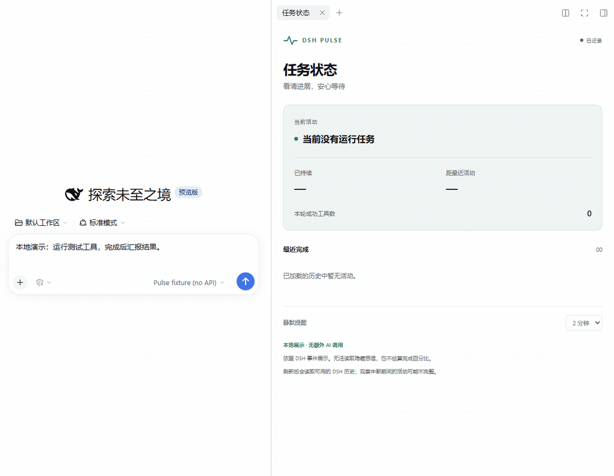

# DSH Task Pulse

[English](README.en.md) · 简体中文 · [下载安装包](https://github.com/Yeti11H/dsh-task-pulse/releases/tag/v0.1.0)

一个轻量的 DeepSeek Harness 任务状态侧栏：看清当前活动、最近完成的操作、等待用户的状态，以及长时间没有新活动的情况。

已发布 `0.1.0` 的状态侧栏不额外调用模型、不新增后端服务、不向 Agent 注入提示词、不改变工具执行。

**本分支新增 GitHub 代码工作台（开发中，未发布）**：复用官方 GitHub CLI 登录，在 DSH 内浏览可折叠文件树、按检查批注跳到代码行、审阅 Agent 的修改 Diff，确认后创建新分支与草稿 PR。可选 Java 17 本地服务与 `pulse_github` Host 工具独立于原状态统计。无需注册 GitHub App。[构建、配对与试用指南](docs/github-workbench.md)。



约 20 秒，使用本地测试模型和延时工具录制真实 DSH 会话；展示模型等待、工具等待、接收输出和完成状态，不代表真实模型响应速度。[静态截图](docs/dsh-complete.png)。项目包名为 `dsh-task-pulse`，与他人的 `dsh-pulse` 项目无关。

## 安装

需要 Node.js **24.9.0 或更高版本**。本分支将宿主版本声明放宽为 **`>=0.2.2-rc.1 <0.3.0`**，这不表示范围内所有版本均已验证。DSH 本身处于开发者预览阶段。

| DSH 版本 | 验证范围 |
| --- | --- |
| `0.2.2-rc.1` | 原状态侧栏在 Windows 网页版已实测；工作台的验证范围见验证记录。 |
| `0.2.2-rc.2` | 类型检查和单元测试通过，构建通过；未在真实 rc.2 DSH 中验证。 |
| 其他版本与桌面版 | 尚未验证。 |

CI 分别安装 rc.1、rc.2 的全部直接 DSH 类型依赖再运行检查。已发布 npm `0.1.0` 的宿主声明仍是精确的 rc.1；本阶段只提交 PR，合并并发布新版本后才会影响市场筛选。下面命令保留已实测的安装组合。

已发布到 [npm](https://www.npmjs.com/package/dsh-task-pulse)，可直接安装指定版本：

```powershell
npx @deepseek-ai/dsh@0.2.2-rc.1 plugin --profile web add dsh-task-pulse@0.1.0
npx @deepseek-ai/dsh@0.2.2-rc.1 web
```

也可以从 [GitHub Releases](https://github.com/Yeti11H/dsh-task-pulse/releases/tag/v0.1.0) 下载 `dsh-task-pulse-0.1.0.tgz`，在下载目录执行：

```powershell
# 网页版
npx @deepseek-ai/dsh@0.2.2-rc.1 plugin --profile web add ./dsh-task-pulse-0.1.0.tgz
npx @deepseek-ai/dsh@0.2.2-rc.1 web
```

如果你已经有同版本的 `dsh` 命令，也可以使用：

```powershell
dsh plugin --profile web add ./dsh-task-pulse-0.1.0.tgz
```

安装后重新启动 DSH，在一个会话中展开右侧栏，点击添加标签页，在工具列表中选择 **Pulse · 任务状态**（英文为 **Pulse · Task status**）。

桌面版使用独立的 `desktop` profile。若桌面版运行的 DSH 版本恰好匹配，可通过其自带的 `dsh` 安装到该 profile；首版实际验证情况见 [验证记录](docs/verification.md)。不要为了安装插件覆盖现有 DSH 配置。

## 状态说明

| 状态 | 依据 |
| --- | --- |
| 等待模型输出 | 已观察到本次模型步骤开始，尚未观察到输出片段。 |
| 正在接收模型输出 | 收到了文本、推理文本或工具调用的流式片段；不会复制其内容。 |
| 正在等待工具结果 | 已记录工具请求，尚未记录对应结果。包含排队、授权、执行等阶段，不保证工具已经开始运行。 |
| 正在等待你处理 | DSH 的会话交互状态或待处理授权记录表明需要用户操作。 |
| 状态待确认 | 当前任务仍被 DSH 标记为运行中，距最近观察到的活动超过阈值。**不代表卡死。** |
| 连接暂不可用 | DSH 连接不可用。原有任务是否仍在运行，插件无法判断。 |
| 本轮已完成／已停止／发生错误 | 使用 DSH 记录的本轮结束原因；不会把中断或达到输出限制当作成功完成。 |

静默提醒可选 30 秒、1 分钟、2 分钟、5 分钟。设置保存在本浏览器中。提醒显示在面板内，不发送系统通知。

最近活动最多保留 12 条。并行工具分别显示等待时间。刷新后根据 DSH 当前提供的历史窗口重新计算，不建立第二套会话数据库。

## 状态侧栏的数据与边界

以下描述只适用于任务状态统计。GitHub 工作台通过本地 Java 服务访问 GitHub；用户让 Agent 读源码时，源码与修改建议会进入 DSH 工具历史，并可能发送给配置的模型。授权权限、内存草稿与发布限制见[工作台指南](docs/github-workbench.md)。

- 使用 DSH 已授权的 Session Controller 和连接状态，不新开网络端口。
- 只在面板挂载时订阅会话事件，关闭面板后释放订阅和计时器。
- 状态记录不复制工具参数、正常工具结果、文件内容或推理正文。
- 失败摘要会保留最多 400 字符，并遮盖部分常见密钥格式。它不是通用脱敏器，错误信息仍可能包含项目名称或路径；分享截图前自行检查。
- 只能看到 DSH 实际提供的信号，无法读取模型隐藏思维，也不显示完成百分比。
- 工具内部的子任务、后台工作和子 Agent 不在首版的独立跟踪范围内。
- 长历史只处理 DSH 当前加载的部分。重连、重启和加载历史可能造成观察空档，不能据此证明完整执行过程。
- 时间按 DSH 事件时间与浏览器时钟计算；远程使用时两端时钟偏差可能影响耗时与静默提醒。
- 会话级等待状态优先于静默提醒；并行调用时，“等待用户”不代表其他工具全部暂停。
- 不自动重试、停止任务、修改文件或恢复会话。处理授权、回答问题和停止任务仍使用 DSH 原有界面。

## 本地开发

```powershell
npm ci
npm run check
npm test
npm run build
npm pack
```

交互预览使用同一个状态卡组件和模拟事件，不需要 DSH 或模型账号：

```powershell
npm run preview
```

打开终端输出的本地地址，可切换工具执行、等待用户、静默、断线、完成和错误场景。

## 项目结构

```text
src/state.ts       纯状态逻辑，不依赖 DSH
src/monitor.ts     读取事件窗口，处理增量、重连和释放订阅
src/client.tsx     接入 DSH 侧栏、会话和本地偏好设置
src/view.tsx       状态卡组件
src/index.ts       可选 pulse_github Host 工具；未配置配对码时不注册
src/github.ts      工作台协议与纯 Diff/定位逻辑
src/github-view.tsx 仓库、代码行与建议审阅界面
github-server/     Java 17 本地 GitHub CLI 桥接服务
tests/            行为验证
preview/          可交互的模拟事件预览
```

## 反馈与发布

找朋友试用时，直接分享 [10 分钟试用清单](docs/try-it.md)，包含安装、测试场景、卸载和反馈格式。也可 [填写试用反馈](https://github.com/Yeti11H/dsh-task-pulse/issues/new?template=trial-feedback.yml)。

通过 [Issues](https://github.com/Yeti11H/dsh-task-pulse/issues) 报告问题。请提供 DSH 版本、使用的网页或桌面环境、期望状态和实际状态；分享日志或截图前检查敏感信息。

首版为预览版。兼容性和验证边界见 [验证记录](docs/verification.md)，版本附件以 [Releases](https://github.com/Yeti11H/dsh-task-pulse/releases) 为准。

## License

MIT。与 DeepSeek 无隶属或官方背书关系。
